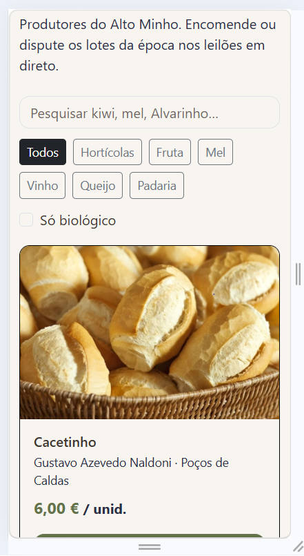
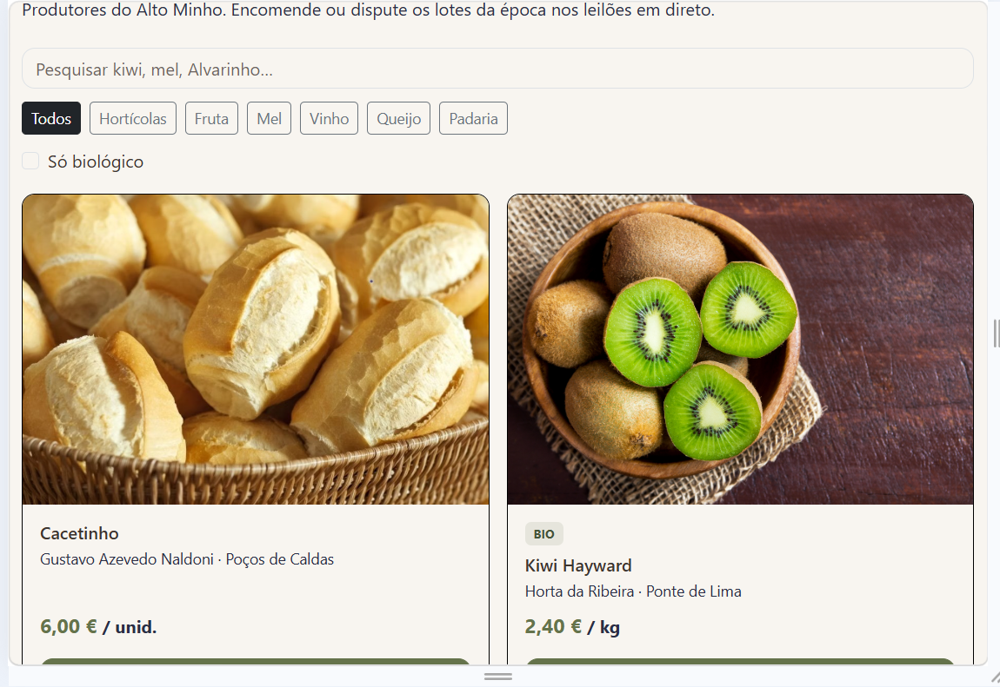
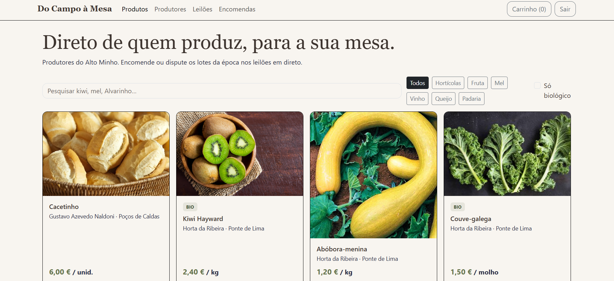

# Relatório — Do Campo à Mesa

**Unidade curricular:** Desenvolvimento Web e para a Cloud  

**Curso:** Mestrado em Engenharia de Software — IPVC–ESTG  

**Aluno:** Lucas Fernandes Gafaria Alves  

**Repositório:** https://github.com/lucasgafaria/do-campo-a-mesa.git

**Aplicação:** Execução local para demonstração  

**Documentação da API:** http://localhost:3000/api-docs

---

## 1. Introdução

O **Do Campo à Mesa** é uma plataforma digital que aproxima produtores agrícolas locais de compradores particulares e estabelecimentos comerciais. O sistema permite a comercialização de produtos por meio de encomendas convencionais e de leilões em tempo real.

O objetivo do trabalho foi desenvolver uma aplicação web que integrasse uma interface interativa, uma API própria, uma base de dados documental, mecanismos de autenticação e autorização, comunicação em tempo real e serviços de armazenamento na Cloud.

A solução foi desenvolvida individualmente, tendo como ponto de partida a estrutura de código fornecida pelo docente.

As principais funcionalidades implementadas são:

- Consulta e pesquisa de produtos agrícolas.
- Cadastro e autenticação de compradores e produtores.
- Aprovação de produtores pelo administrador.
- Gestão de produtos, preços, estoque e imagens.
- Consulta das páginas públicas dos produtores.
- Criação e acompanhamento de encomendas.
- Atualização do estado das encomendas e notificações em tempo real.
- Criação e participação em leilões.
- Histórico de licitações e encerramento automático dos leilões.
- Avaliação de encomendas entregues e denúncia de avaliações.
- Painel administrativo para aprovação de produtores, moderação e consulta de estatísticas.

A aplicação contempla quatro papéis:

| Papel | Permissões principais |
|---|---|
| Visitante | Consultar produtos, produtores e leilões; realizar cadastro e login |
| Comprador | Gerenciar carrinho, criar encomendas, acompanhar pedidos, licitar e avaliar |
| Produtor | Gerenciar produtos e imagens, criar leilões e atualizar encomendas |
| Administrador | Aprovar produtores, moderar avaliações e consultar estatísticas |

A autorização não depende apenas da interface. As permissões são verificadas também no servidor, por meio de tokens JWT e middlewares específicos.

## 2. Arquitetura

A aplicação utiliza uma arquitetura cliente-servidor. O frontend é desenvolvido em React, enquanto o backend utiliza Node.js e Express para disponibilizar a API REST e Socket.io para a comunicação em tempo real.

O MongoDB é utilizado para persistência dos dados, e o Azure Blob Storage para armazenar as imagens dos produtos.

### 2.1 Componentes da arquitetura

**Frontend — React e Vite**

Responsável pela interface apresentada ao usuário. Comunica-se com a API por meio de requisições HTTP e com o servidor Socket.io para receber atualizações em tempo real.

**Backend — Node.js e Express**

Responsável pelas regras de negócio, autenticação, autorização, validação dos dados e acesso à base de dados.

**Socket.io**

Permite a comunicação em tempo real entre os participantes dos leilões e o envio de notificações relacionadas às encomendas.

**MongoDB Atlas**

Armazena os usuários, produtos, encomendas, leilões, licitações e avaliações.

**Azure Blob Storage**

Armazena as imagens dos produtos. A aplicação mantém na base de dados o endereço público de cada imagem, em vez de armazenar o arquivo diretamente no MongoDB.

### 2.2 Organização do servidor

O arquivo `api/src/server.js` cria um servidor HTTP compartilhado pela aplicação Express e pelo Socket.io.

Essa organização permite que a API REST e os eventos em tempo real utilizem o mesmo servidor.

A instância do Socket.io também é disponibilizada à aplicação para que determinadas rotas possam emitir notificações, como acontece quando o produtor altera o estado de uma encomenda.

O serviço `api/src/services/cicloLeiloes.js` executa verificações periódicas, a cada cinco segundos, para ativar leilões cujo horário de início chegou e encerrar aqueles cujo prazo terminou.

### 2.3 Comunicação entre os componentes

A comunicação acontece da seguinte forma:

- O frontend realiza requisições HTTP para os endpoints da API.
- O token JWT é enviado no cabeçalho `Authorization: Bearer`.
- O Socket.io utiliza o mesmo mecanismo de autenticação por token.
- O backend consulta e atualiza os documentos no MongoDB.
- O serviço de imagens envia arquivos para o Azure Blob Storage.
- O endereço retornado pelo armazenamento é salvo no documento do produto.

A arquitetura foi pensada para permitir a separação entre interface, regras de negócio, persistência e serviços externos.

## 3. Frontend e SPA

### 3.1 Framework e ferramentas

Foi utilizado React 18 com Vite para desenvolver a aplicação de página única (SPA).

O React permite dividir a interface em componentes reutilizáveis, enquanto o Vite disponibiliza o ambiente de desenvolvimento e o processo de compilação.

Para a construção visual foram utilizados Bootstrap 5 e SASS. O Bootstrap fornece componentes e uma estrutura de responsividade, enquanto o SASS permite organizar e personalizar os estilos.

### 3.2 Componentes e páginas

A aplicação possui páginas organizadas de acordo com os diferentes papéis.

| Área | Funcionalidades |
|---|---|
| Pública | Catálogo, listagem de produtores, página individual do produtor, leilões, login e cadastro |
| Comprador | Carrinho, sala de leilão e encomendas |
| Produtor | Painel, gerenciamento de produtos, cadastro de leilões e acompanhamento de encomendas |
| Administrador | Painel administrativo, aprovação de produtores e moderação de avaliações |

Entre os componentes reutilizáveis estão a barra de navegação, os cartões de produtos, os indicadores de estado das encomendas e o componente de proteção de rotas.

### 3.3 Gerenciamento de estado

O estado da aplicação foi dividido de acordo com sua finalidade.

**Context API**

O `AuthContext` mantém os dados da sessão autenticada e disponibiliza as operações de login, cadastro e logout. A sessão é armazenada no `localStorage`, permitindo sua recuperação após a atualização da página.

O `CarrinhoContext` mantém os produtos selecionados e suas quantidades.

**Hooks personalizados**

O hook `useLeilao(id, token)` concentra a comunicação com o Socket.io e mantém informações como o leilão, o valor atual, o histórico de licitações e a quantidade de participantes.

O hook `useNotificacoes()` acompanha as notificações recebidas pelo usuário.

**Estado local**

O `useState` é utilizado nos formulários, filtros, mensagens de erro e demais informações específicas de cada página.

Não foi necessário utilizar Redux, pois a Context API e os estados locais atenderam às necessidades da aplicação.

### 3.4 Navegação

A navegação é implementada com React Router.

As rotas são organizadas de acordo com os papéis dos usuários e protegidas pelo componente `RotaProtegida`.

Esse componente controla o acesso às páginas privadas e redireciona usuários que não possuem a autenticação ou o papel necessário.

Entretanto, a proteção visual não substitui a autorização no backend. As rotas da API também verificam o token, o papel e, quando necessário, a propriedade do recurso solicitado.

### 3.5 Responsividade

A interface utiliza Bootstrap e estilos personalizados em SASS para adaptar a apresentação a diferentes tamanhos de tela.

Foram utilizadas classes responsivas da estrutura de grelha do Bootstrap e regras de estilo específicas para diferentes larguras.

**Capturas de tela a inserir:**

- 
- 
- 

As capturas devem ser obtidas diretamente da aplicação em execução.

## 4. API REST e documentação

### 4.1 Organização dos recursos

A API foi desenvolvida com Express e utiliza o prefixo `/api`.

Os recursos são organizados em rotas próprias, separadas por responsabilidade.

| Recurso | Método e caminho | Acesso | Descrição |
|---|---|---|---|
| Saúde | `GET /api/health` | Público | Verificar funcionamento da API |
| Autenticação | `POST /api/auth/registo` | Público | Criar conta |
| Autenticação | `POST /api/auth/login` | Público | Autenticar usuário |
| Autenticação | `GET /api/auth/eu` | Autenticado | Consultar usuário autenticado |
| Produtos | `GET /api/products` | Público | Listar e filtrar produtos |
| Produtos | `GET /api/products/:id` | Público | Consultar produto |
| Produtos | `POST /api/products` | Produtor validado | Criar produto |
| Produtos | `PUT /api/products/:id` | Produtor validado, proprietário | Atualizar produto |
| Produtos | `DELETE /api/products/:id` | Produtor validado, proprietário | Remover produto |
| Produtos | `POST /api/products/:id/imagem` | Produtor validado, proprietário | Enviar imagem |
| Produtores | `GET /api/producers` | Público | Listar produtores validados |
| Produtores | `GET /api/producers/:id` | Público | Consultar página pública |
| Encomendas | `POST /api/orders` | Comprador | Criar encomenda |
| Encomendas | `GET /api/orders` | Comprador ou produtor | Consultar encomendas permitidas |
| Encomendas | `GET /api/orders/:id` | Comprador ou produtor | Consultar encomenda |
| Encomendas | `PATCH /api/orders/:id/estado` | Produtor autorizado | Atualizar estado |
| Leilões | `POST /api/auctions` | Produtor validado | Criar leilão |
| Leilões | `GET /api/auctions` | Público | Listar leilões |
| Leilões | `GET /api/auctions/:id` | Público | Consultar leilão |
| Leilões | `GET /api/auctions/:id/bids` | Público | Consultar histórico de licitações |
| Avaliações | `POST /api/reviews` | Comprador | Avaliar encomenda entregue |
| Avaliações | `GET /api/reviews` | Público | Consultar avaliações visíveis |
| Avaliações | `POST /api/reviews/:id/denuncia` | Autenticado | Denunciar avaliação |
| Administração | `GET /api/admin/estatisticas` | Administrador | Consultar estatísticas |
| Administração | `GET /api/admin/produtores/pendentes` | Administrador | Listar produtores pendentes |
| Administração | `PATCH /api/admin/produtores/:id/validacao` | Administrador | Aprovar ou rejeitar produtor |
| Administração | `GET /api/admin/reviews/denunciadas` | Administrador | Consultar avaliações denunciadas |
| Administração | `PATCH /api/admin/reviews/:id` | Administrador | Ocultar ou reativar avaliação |

### 4.2 Códigos HTTP

A API utiliza os códigos HTTP para indicar o resultado das operações.

| Código | Utilização |
|---|---|
| `200 OK` | Consulta ou alteração realizada |
| `201 Created` | Recurso criado |
| `204 No Content` | Recurso removido sem conteúdo de resposta |
| `400 Bad Request` | Dados inválidos ou incompletos |
| `401 Unauthorized` | Token ausente, inválido ou credenciais incorretas |
| `403 Forbidden` | Usuário sem permissão |
| `404 Not Found` | Recurso não encontrado ou não acessível |
| `409 Conflict` | Conflito de dados, duplicidade ou transição não permitida |
| `500 Internal Server Error` | Erro interno não previsto |

As operações de atualização de estado de encomendas seguem uma sequência definida: `pendente`, `confirmada`, `pronta` e `entregue`. A API valida as transições para impedir alterações incompatíveis com o fluxo previsto.

### 4.3 Documentação OpenAPI e Swagger

A API possui um arquivo `api/openapi.yaml`, escrito segundo a especificação OpenAPI 3.0.3.

A documentação é disponibilizada por meio do Swagger UI, utilizando as bibliotecas `swagger-ui-express` e `yamljs`.

O Swagger permite consultar os caminhos documentados e visualizar as operações da API. Também apresenta o mecanismo de autenticação Bearer JWT.

**Endereço local:** http://localhost:3000/api-docs

A documentação existente representa uma versão inicial e simplificada da especificação. Nem todas as operações possuem detalhamento completo de parâmetros, corpos de requisição e respostas, sendo esse um ponto de melhoria.

## 5. Modelo de dados

### 5.1 Coleções

A persistência utiliza MongoDB e Mongoose. Os principais dados estão organizados em seis coleções.

| Coleção | Conteúdo |
|---|---|
| `users` | Usuários, credenciais protegidas, papéis e informações dos produtores |
| `products` | Produtos, preços, estoque, categorias, épocas e endereços das imagens |
| `orders` | Comprador, produtor, linhas da encomenda, estado e informações de entrega |
| `auctions` | Produtor, lote, preço inicial, incremento, licitação atual e horários |
| `bids` | Histórico de licitações, comprador, leilão e valor |
| `reviews` | Avaliações, classificação, comentário, denúncias e visibilidade |

### 5.2 Embedding e linking

Foram utilizadas duas formas de representar relacionamentos.

**Embedding**

Os dados específicos do produtor são armazenados dentro do documento do usuário. As linhas da encomenda também são armazenadas no próprio documento, incluindo uma cópia do nome e do preço do produto no momento da compra.

A licitação atual também fica embutida no documento do leilão, permitindo consultar e atualizar o valor atual diretamente.

**Linking**

Produtos, encomendas, usuários, avaliações e licitações possuem referências a outras coleções quando as entidades precisam ser consultadas ou gerenciadas independentemente.

As licitações são armazenadas em uma coleção própria porque um leilão pode receber muitos registros ao longo do tempo. Essa organização evita o crescimento contínuo do documento principal do leilão.

### 5.3 Índices

Foram identificados os seguintes índices e restrições:

| Coleção | Índice ou restrição | Finalidade |
|---|---|---|
| `users` | Email único | Evitar cadastros duplicados |
| `orders` | Referência ao leilão única e esparsa | Impedir mais de uma encomenda para o mesmo leilão |
| `bids` | Referência ao leilão | Facilitar a consulta do histórico |
| `reviews` | Referência à encomenda única | Impedir mais de uma avaliação por encomenda |
| `reviews` | Produtor, visibilidade e data | Consultar avaliações visíveis por produtor |

Não foram identificados índices personalizados equivalentes para todos os filtros do catálogo. A criação de índices adicionais para pesquisa e filtragem é uma melhoria possível.

### 5.4 Consultas e operações

A API utiliza consultas Mongoose para filtrar produtos, consultar produtores, obter avaliações e calcular estatísticas administrativas.

Também utiliza operações de agregação do MongoDB para obter informações como médias de avaliações e totais de encomendas.

Um exemplo importante de atualização atômica está na reserva de estoque: a API verifica se existe quantidade suficiente e decrementa o estoque na mesma operação. Isso reduz o risco de duas encomendas simultâneas reservarem unidades que já não estão disponíveis.

## 6. Segurança

### 6.1 Autenticação JWT

A autenticação utiliza JSON Web Tokens.

No cadastro ou login, a API gera um token assinado com um segredo armazenado em variável de ambiente.

O token contém informações de identificação e papel do usuário e possui validade configurável.

O frontend envia o token no cabeçalho `Authorization: Bearer` nas operações protegidas. O Socket.io também utiliza o token durante o processo de conexão.

### 6.2 Autorização por papel

A aplicação possui os papéis comprador, produtor e administrador.

O middleware `auth` verifica a validade do token e o papel do usuário.

O middleware `produtorValidado` consulta o cadastro do produtor e impede que uma conta ainda não aprovada realize operações de venda.

Além disso, o backend verifica a propriedade dos recursos. Um produtor não pode alterar produtos de outro produtor, e os usuários só podem consultar ou alterar encomendas às quais tenham acesso.

O cadastro público permite somente os papéis comprador e produtor, impedindo a criação livre de contas administrativas.

### 6.3 Proteção de senhas

As senhas são armazenadas por meio de hashes gerados com bcryptjs, utilizando custo 12.

O campo `passwordHash` está configurado com `select: false` no modelo de usuário, evitando que seja retornado nas consultas comuns.

Durante o login, o hash é recuperado explicitamente para comparação com a senha fornecida.

### 6.4 Validação de dados e upload

As rotas validam campos obrigatórios, valores, identificadores e permissões antes de realizar operações no banco.

O upload de imagens utiliza Multer e aceita arquivos JPEG, PNG e WebP com limite de 5 MB.

Os arquivos recebem identificadores aleatórios antes de serem enviados ao Azure Blob Storage.

### 6.5 Gestão de segredos

As informações sensíveis são mantidas em variáveis de ambiente, como:

- `MONGODB_URI`
- `JWT_SECRET`
- `STORAGE_CONN`
- `STORAGE_CONTAINER`
- `CLIENT_URL`

O arquivo `.env` está incluído no `.gitignore`, evitando que credenciais sejam adicionadas ao repositório.

O projeto disponibiliza um arquivo `.env.example` com os nomes das variáveis necessárias, sem seus valores secretos.

## 7. Tempo real e consistência dos leilões

### 7.1 Salas do Socket.io

A aplicação utiliza salas para organizar a comunicação entre os participantes.

| Sala | Utilização |
|---|---|
| `user:<id>` | Receber notificações destinadas a um usuário |
| `leilao:<id>` | Receber atualizações relacionadas a um leilão |

Ao estabelecer a conexão, o usuário autenticado entra na sua sala pessoal. Ao acessar uma sala de leilão, o socket entra na sala correspondente.

### 7.2 Eventos

Entre os principais eventos utilizados estão:

| Evento | Finalidade |
|---|---|
| `entrar` | Entrar em uma sala de leilão |
| `sair` | Sair de uma sala |
| `licitar` | Enviar uma nova licitação |
| `estado` | Receber o estado atual do leilão |
| `nova-licitacao` | Informar uma nova oferta aos participantes |
| `recusada` | Informar que uma oferta não foi aceita |
| `presenca` | Atualizar o número de participantes |
| `iniciado` | Informar que o leilão começou |
| `terminado` | Informar que o leilão terminou |
| `leilao-ganho` | Notificar o comprador vencedor |
| `leilao-terminado` | Notificar o produtor |
| `encomenda-atualizada` | Informar uma mudança no estado da encomenda |

O evento `licitar` utiliza o mecanismo de confirmação do Socket.io, conhecido como acknowledgement. Dessa forma, o cliente recebe uma resposta indicando se a oferta foi aceita ou recusada.

### 7.3 Licitações simultâneas

Um dos desafios técnicos foi impedir que duas ofertas simultâneas fossem aceitas com base no mesmo valor anterior.

Uma implementação baseada apenas em leitura, comparação e gravação separadas poderia permitir que dois compradores lessem o mesmo valor e enviassem ofertas concorrentes.

Para evitar esse problema, o código utiliza `Auction.findOneAndUpdate()` com condições no próprio filtro.

A operação verifica, entre outras condições:

- Se o leilão existe.
- Se o estado permite licitações.
- Se o horário atual está dentro do período do leilão.
- Se o comprador não é o produtor.
- Se a oferta respeita o incremento mínimo.

A atualização do valor e do comprador acontece na mesma operação sobre o documento do leilão.

Foi realizado um teste manual com duas conexões Socket.io enviando simultaneamente ofertas de mesmo valor. O resultado foi uma oferta aceita e outra recusada, demonstrando o funcionamento da proteção contra essa situação específica.

### 7.4 Encerramento automático

O serviço `api/src/services/cicloLeiloes.js` executa verificações periódicas a cada cinco segundos.

O processo identifica leilões cujo horário de início chegou e altera seu estado para ativo.

Quando o horário de encerramento é atingido, o serviço verifica se existe um comprador vencedor.

Se não houver comprador, o leilão é marcado como terminado e o produtor recebe uma notificação.

Se houver vencedor, o serviço consulta a coleção `bids` para confirmar que o lance correspondente está registrado. Em seguida, cria uma encomenda associada ao leilão e marca o leilão como terminado.

O modelo de encomenda possui uma restrição de unicidade para a referência do leilão. Isso ajuda a impedir a criação de mais de uma encomenda para o mesmo leilão.

Se a encomenda já tiver sido criada em uma execução anterior, o código trata a duplicidade e consulta a encomenda existente.

### 7.5 Limitação identificada

A atualização do documento do leilão e a criação do registro correspondente na coleção `bids` são realizadas em operações separadas.

Isso significa que, caso a atualização do leilão seja concluída e a gravação do lance falhe, pode ocorrer uma inconsistência entre a licitação atual e o histórico.

O serviço de encerramento procura o lance vencedor na coleção `bids`. Se não encontrar esse registro, não cria a encomenda e não conclui o encerramento naquele ciclo.

Essa situação foi identificada como uma limitação da implementação. Uma melhoria futura seria utilizar uma transação do MongoDB para garantir que a atualização do leilão e a gravação da licitação sejam confirmadas conjuntamente.

## 8. Deployment e serviços na Cloud

### 8.1 Serviços utilizados

O projeto utiliza serviços gerenciados para persistência e armazenamento de imagens.

| Componente | Serviço | Utilização |
|---|---|---|
| Banco de dados | MongoDB Atlas | Persistência dos dados da aplicação |
| Imagens | Azure Blob Storage | Armazenamento dos arquivos enviados pelos produtores |
| Aplicação | Azure App Service | Serviço configurado para hospedar o backend e a aplicação |
| Desenvolvimento | Ambiente local | Execução e demonstração da aplicação |

O MongoDB Atlas foi configurado e recebeu os dados utilizados pelo projeto.

O Azure Blob Storage também foi configurado, com um contêiner destinado às imagens dos produtos. O envio de imagens foi testado, e os endereços retornados foram armazenados nos documentos do MongoDB.

### 8.2 Tentativa de publicação da aplicação

Foi criado e configurado um Azure App Service para hospedar a aplicação.

Também foram preparadas as configurações de ambiente necessárias para a conexão com o MongoDB Atlas, o Azure Blob Storage e a autenticação.

Entretanto, a publicação não foi concluída. Durante o processo, o serviço apresentou problemas de quota (`QuotaExceeded`), e a verificação pública da API retornou HTTP 403.

Por esse motivo, a aplicação não ficou disponível publicamente para acesso externo.

A versão funcional do sistema foi mantida no ambiente local, onde o frontend e a API podem ser executados para demonstração.

Assim, é importante distinguir a configuração dos serviços de dados na Cloud da publicação efetiva da aplicação: o MongoDB Atlas e o Azure Blob Storage foram utilizados com sucesso, mas o deployment da aplicação no Azure App Service permaneceu incompleto.

### 8.3 Configuração e segurança

As credenciais de acesso aos serviços são mantidas em variáveis de ambiente.

O arquivo `.env` não deve ser compartilhado nem enviado ao repositório. O arquivo `.env.example` apresenta somente os nomes das configurações necessárias.

A configuração local utiliza os endereços de desenvolvimento do frontend e da API.

### 8.4 Custos e limitações

Foi utilizado um plano gratuito F1 para a tentativa de hospedagem no Azure App Service. A publicação foi limitada por problemas de quota.

O MongoDB Atlas e o Azure Blob Storage foram configurados conforme os planos e recursos disponíveis nas respectivas contas.

Não é apresentado um custo mensal definitivo, pois isso dependeria da confirmação dos planos efetivamente utilizados, do consumo de armazenamento, das operações realizadas e das condições da conta Azure.

## 9. Dificuldades e trabalho futuro

### 9.1 Principais dificuldades

Durante o desenvolvimento, algumas funcionalidades exigiram maior atenção.

**Autenticação e autorização**

Foi necessário implementar a autenticação com JWT e separar as permissões de compradores, produtores e administradores. Também foi necessário impedir que produtores não aprovados realizassem operações de venda.

**Gerenciamento de imagens**

A integração entre Multer, Azure Blob Storage e MongoDB exigiu organizar o envio do arquivo e o armazenamento do endereço correspondente no produto.

**Encomendas e estoque**

A criação de encomendas exige verificar a disponibilidade dos produtos e atualizar o estoque. A reserva é feita com uma operação condicional no MongoDB para evitar que a quantidade disponível fique negativa.

**Comunicação em tempo real**

A implementação dos leilões exigiu compreender o funcionamento das salas do Socket.io, a autenticação das conexões e a transmissão de eventos entre os participantes.

**Concorrência nas licitações**

Foi necessário utilizar uma atualização atômica do documento do leilão para impedir que ofertas simultâneas de mesmo valor fossem aceitas.

**Encerramento automático**

O serviço de encerramento precisou considerar leilões sem vencedor, criação de encomendas, notificações e prevenção de duplicidade.

**Publicação na Cloud**

Apesar da configuração do MongoDB Atlas e do Azure Blob Storage, a publicação no Azure App Service foi limitada por problemas de quota, impedindo a disponibilização pública da aplicação.

### 9.2 Melhorias futuras

Algumas melhorias foram identificadas durante o desenvolvimento:

- Utilizar transações MongoDB para garantir consistência entre a atualização do leilão e o registro da licitação.
- Ampliar a documentação OpenAPI, incluindo corpos de requisição, parâmetros e respostas detalhadas.
- Criar testes automatizados de integração para a API e para os eventos Socket.io.
- Criar índices adicionais para otimizar as consultas do catálogo, conforme o comportamento de pesquisa.
- Ampliar os filtros e as opções de ordenação na interface do catálogo.
- Implementar mecanismos de limitação de tentativas de login e cabeçalhos adicionais de segurança.
- Adicionar histórico de alterações dos estados das encomendas.
- Melhorar a escalabilidade do Socket.io utilizando um adaptador Redis caso a aplicação passe a executar em várias instâncias.
- Concluir a publicação da aplicação em um serviço Cloud compatível com as necessidades do projeto.

## 10. Ferramentas, bibliotecas e uso de inteligência artificial

### 10.1 Tecnologias e bibliotecas

| Camada | Tecnologia | Utilização |
|---|---|---|
| Frontend | React | Construção da interface |
| Frontend | Vite | Ambiente de desenvolvimento e compilação |
| Frontend | React Router | Navegação entre páginas |
| Frontend | Bootstrap | Componentes e estrutura responsiva |
| Frontend | SASS | Personalização dos estilos |
| Frontend | Socket.io Client | Comunicação em tempo real |
| Backend | Node.js | Ambiente de execução |
| Backend | Express | API REST |
| Backend | Mongoose | Modelagem e acesso ao MongoDB |
| Backend | Socket.io | Comunicação em tempo real |
| Backend | JSON Web Token | Autenticação |
| Backend | bcryptjs | Proteção de senhas |
| Backend | Multer | Recepção de arquivos |
| Cloud | Azure Blob Storage SDK | Armazenamento de imagens |
| Documentação | OpenAPI e Swagger UI | Documentação e consulta da API |
| Controle de versão | Git | Histórico das alterações |

O desenvolvimento partiu do código-base disponibilizado pelo docente. A estrutura inicial foi ampliada com a implementação das funcionalidades, regras de negócio, páginas e integrações necessárias.

### 10.2 Assistentes de inteligência artificial

Durante o desenvolvimento foram utilizados assistentes de inteligência artificial como ferramentas de apoio.

| Ferramenta | Utilização |
|---|---|
| ChatGPT | Esclarecimento de conceitos, orientação durante a implementação, análise de erros, revisão de código, apoio nos testes e organização da documentação |
| Claude | Apoio na análise do código e na elaboração inicial do relatório acadêmico |

Os assistentes foram utilizados como apoio ao processo de aprendizagem e desenvolvimento. As sugestões foram analisadas e adaptadas ao projeto, e o funcionamento das funcionalidades foi verificado por meio da execução da aplicação e de testes.

A responsabilidade pelo código, pelas decisões técnicas, pela validação do funcionamento e pelo conteúdo final do trabalho permanece com o aluno.

---

**Observação final:** a aplicação foi desenvolvida e testada localmente, com integração funcional ao MongoDB Atlas e ao Azure Blob Storage. A publicação pública no Azure App Service não foi concluída devido a limitações de quota do serviço.