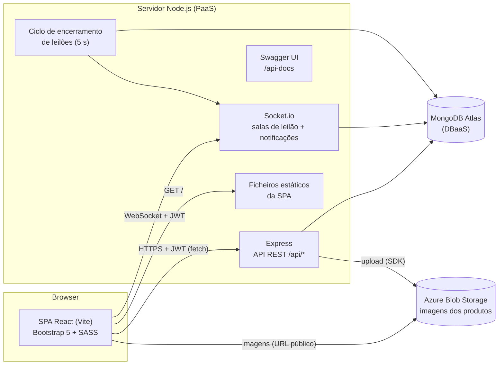
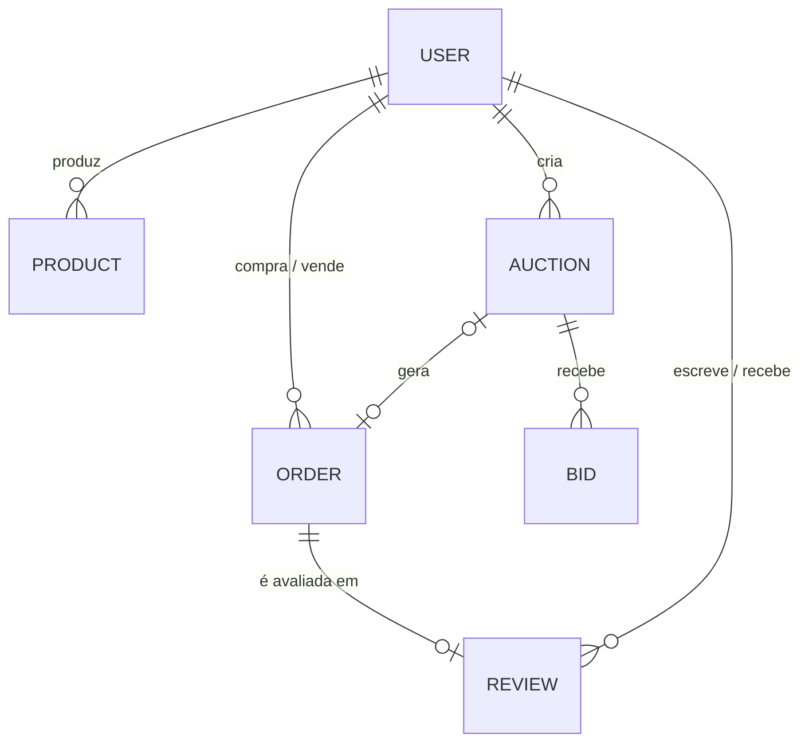

# Relatório · Do Campo à Mesa

**Unidade curricular:** Desenvolvimento Web e para a Cloud · Mestrado em Engenharia Informática · IPVC–ESTG
**Aluno:** [PREENCHER: nome e número]
**Repositório:** [PREENCHER: URL do repositório GitHub]
**Aplicação publicada:** [PREENCHER: URL público] · **Documentação da API:** [PREENCHER: URL público]/api-docs

---

## 1. Introdução

O *Do Campo à Mesa* é um mercado digital que liga produtores locais (hortícolas, fruta, mel, vinho, queijo, padaria) a compradores particulares e a restaurantes. Para além da venda direta a preço fixo, a plataforma permite que os produtores coloquem lotes em **leilão em direto**, onde os compradores licitam em tempo real.

O objetivo do trabalho foi desenvolver, de forma individual, uma aplicação web completa e publicada na Cloud, cobrindo:

- uma **SPA** responsiva (*Mobile First*) em React;
- uma **API REST** em Node.js/Express documentada com OpenAPI (Swagger);
- persistência em **MongoDB**, com decisões justificadas de modelação;
- **autenticação e autorização** com JWT e papéis;
- **comunicação em tempo real** com Socket.io para os leilões e notificações;
- **deployment** em serviços Cloud, incluindo armazenamento de imagens.

A aplicação tem quatro intervenientes:

| Papel | O que pode fazer |
|---|---|
| Visitante | Consultar o catálogo, pesquisar e filtrar produtos, ver produtores e leilões |
| Comprador | Gerir o carrinho, fazer encomendas, acompanhar o estado, licitar em leilões, avaliar e denunciar avaliações |
| Produtor | Gerir os seus produtos (com imagem), criar leilões, gerir o estado das encomendas recebidas |
| Administrador | Validar produtores, moderar avaliações denunciadas, consultar estatísticas |

Os produtores só podem vender depois de o administrador validar a conta.

---

## 2. Arquitetura

A solução segue uma arquitetura cliente–servidor com três camadas: a SPA no browser, um único servidor Node.js que expõe a API REST e o servidor de sockets, e os serviços de dados na Cloud.



**Componentes:**

- **SPA (React + Vite):** interface única para os quatro papéis. Comunica com a API por `fetch` (módulo `api/client.js`, que acrescenta o cabeçalho `Authorization: Bearer <token>`) e com o servidor de sockets através do `socket.io-client`.
- **Servidor HTTP partilhado (`server.js`):** um único processo Node.js cria o servidor HTTP, monta a aplicação Express e liga-lhe o Socket.io. A instância `io` é disponibilizada às rotas (`app.set('io', io)`) para que a API possa emitir notificações (por exemplo, quando uma encomenda muda de estado).
- **API REST (Express):** sete grupos de rotas (`auth`, `products`, `producers`, `orders`, `auctions`, `reviews`, `admin`), middleware de autenticação por papel e tratamento centralizado de erros.
- **Servidor de sockets (Socket.io):** autenticação com o mesmo JWT da API, uma sala pessoal por utilizador (`user:<id>`) e uma sala por leilão (`leilao:<id>`).
- **Serviço de encerramento de leilões (`services/cicloLeiloes.js`):** corre a cada 5 segundos, fecha os leilões cujo prazo terminou, cria a encomenda do vencedor e notifica os participantes.
- **MongoDB:** base de dados documental com seis coleções (secção 5).
- **Storage na Cloud:** as imagens dos produtos são enviadas para o Azure Blob Storage e a base de dados guarda apenas o URL.

Em produção, a SPA é compilada pelo Vite (`npm run build`) e os ficheiros gerados são servidos pelo próprio Express (pasta `public`). Assim a aplicação inteira fica num só serviço, com um único domínio, o que evita problemas de CORS e simplifica o HTTPS. As rotas desconhecidas fora de `/api` devolvem o `index.html` para que o *routing* do React funcione ao recarregar a página; as rotas desconhecidas dentro de `/api` devolvem `404` em JSON.

---

## 3. Frontend e SPA

### 3.1 Framework e ferramentas

Foi escolhido o **React 18** com o **Vite** como ferramenta de build:

- o React tem um modelo de componentes simples e um ecossistema grande (React Router, cliente Socket.io), com muita documentação;
- os *hooks* permitem isolar a lógica de tempo real (ligação ao socket, eventos, limpeza) em funções reutilizáveis;
- o Vite arranca o servidor de desenvolvimento quase instantaneamente e compila SASS sem configuração adicional.

Para os estilos foi usado o **Bootstrap 5** personalizado com **SASS**: as variáveis do Bootstrap (`$primary`, `$success`, `$body-bg`, `$border-radius`…) são redefinidas em `_variables.scss` com a paleta da marca (verde, terracota, argila e fundo creme), de modo que todos os componentes do Bootstrap herdam a identidade visual.

### 3.2 Componentes e páginas

| Tipo | Ficheiros | Função |
|---|---|---|
| Componentes | `Navbar`, `CartaoProduto`, `EstadoEncomenda`, `RotaProtegida`, `PorImplementar` | Menu adaptado ao papel, cartão de produto do catálogo, indicador visual do estado da encomenda, proteção de rotas |
| Páginas públicas | `Catalogo`, `Produtores`, `Produtor`, `Leiloes`, `Login`, `Registo`, `NaoEncontrado` | Catálogo com pesquisa e filtros, lista e página pública de produtores, lista de leilões, autenticação |
| Comprador | `Carrinho`, `SalaLeilao`, `Encomendas` | Carrinho e checkout, sala de leilão em direto, histórico de encomendas |
| Produtor | `produtor/Painel`, `produtor/Produtos`, `produtor/NovoLeilao`, `Encomendas` | Painel, gestão de produtos com upload de imagem, criação de leilões, avanço do estado das encomendas |
| Administrador | `admin/Painel` | Validação de produtores, moderação de avaliações, estatísticas |

### 3.3 Gestão de estado

O estado foi dividido por âmbito:

- **Estado global com Context API:**
  - `AuthContext` guarda o token JWT e os dados do utilizador autenticado e expõe `login`, `registo` e `logout`. A sessão é guardada no `localStorage` (chave `sessao`) para sobreviver a um *refresh* da página.
  - `CarrinhoContext` guarda as linhas do carrinho (produto e quantidade) e as operações para adicionar, alterar e remover.
- **Estado de tempo real em *hooks* próprios:**
  - `useLeilao(id, token)` liga-se ao socket, entra na sala do leilão, mantém o leilão, a licitação atual, o histórico, o número de participantes e o resultado do encerramento, e expõe a função `licitar`. Ao desmontar o componente, sai da sala e desliga o socket.
  - `useNotificacoes()` mantém uma lista de notificações recebidas na sala pessoal do utilizador (por exemplo, `encomenda-atualizada`).
- **Estado local (`useState`)** nas páginas, para formulários, filtros e mensagens de erro.

Não foi necessário usar uma biblioteca como Redux: o volume de estado partilhado é pequeno e a Context API é suficiente.

### 3.4 Routing

O *routing* é feito no cliente com o **React Router 6** (`App.jsx`). As rotas estão agrupadas por interveniente e as rotas privadas estão envolvidas pelo componente `RotaProtegida`, que recebe a lista de papéis permitidos:

| Interveniente | Rotas |
|---|---|
| Visitante | `/`, `/produtores`, `/produtores/:id`, `/leiloes`, `/login`, `/registo` |
| Comprador | `/carrinho`, `/leiloes/:id` |
| Comprador e produtor | `/encomendas` |
| Produtor | `/produtor`, `/produtor/produtos`, `/produtor/leiloes/novo` |
| Administrador | `/admin` |
| Qualquer outra | `NaoEncontrado` (404) |

Se o utilizador não estiver autenticado, `RotaProtegida` redireciona para `/login`; se estiver autenticado mas com outro papel, redireciona para o catálogo. No caso do login, a página de origem é guardada para que o utilizador volte a ela depois de entrar. Esta proteção é apenas de usabilidade: a verdadeira autorização é feita pela API (secção 6).

### 3.5 Mobile First e breakpoints

Os estilos base foram escritos para o ecrã de telemóvel e são acrescentados regras para ecrãs maiores através do mixin `a-partir-de()`:

```scss
$breakpoints: (md: 768px, lg: 1024px, xl: 1280px);

@mixin a-partir-de($bp) {
  @media (min-width: map-get($breakpoints, $bp)) { @content; }
}
```

Exemplo na grelha do catálogo:

| Largura | Colunas |
|---|---|
| < 768 px (telemóvel) | 1 |
| ≥ 768 px (tablet) | 2 |
| ≥ 1024 px (portátil) | 3 |
| ≥ 1280 px (ecrã grande) | 4 |

O mesmo mixin é usado no título principal (tamanho de letra maior em `lg`) e no layout de duas colunas (conteúdo + barra lateral de `22rem`) a partir de `lg`. Nas restantes páginas foram usadas as classes de grelha do Bootstrap (`col-md-*`, `col-lg-*`), que seguem a mesma lógica *Mobile First*.

[PREENCHER: 2 ou 3 capturas de ecrã do catálogo em telemóvel, tablet e desktop.]

---

## 4. API REST e documentação

### 4.1 Recursos e verbos

Todos os recursos estão sob o prefixo `/api`. Os nomes dos recursos estão no plural e as ações são expressas pelo verbo HTTP.

| Recurso | Método e caminho | Acesso | Descrição |
|---|---|---|---|
| Saúde | `GET /health` | público | Verificar se a API está ativa |
| Autenticação | `POST /auth/registo` | público | Criar conta (comprador ou produtor) |
| | `POST /auth/login` | público | Obter token JWT |
| | `GET /auth/eu` | autenticado | Dados do utilizador do token |
| Produtos | `GET /products` | público | Pesquisa com `q`, `categoria`, `precoMax`, `bio`, `epoca` |
| | `GET /products/:id` | público | Detalhe de um produto |
| | `POST /products` | produtor validado | Criar produto |
| | `PUT /products/:id` | produtor validado (dono) | Alterar produto |
| | `DELETE /products/:id` | produtor validado (dono) | Remover produto |
| | `POST /products/:id/imagem` | produtor validado (dono) | Upload da imagem (multipart, máx. 5 MB) |
| Produtores | `GET /producers` | público | Produtores validados, com nº de produtos e avaliação média |
| | `GET /producers/:id` | público | Página pública: dados, produtos e avaliações |
| Encomendas | `POST /orders` | comprador | Criar encomenda (reserva o stock) |
| | `GET /orders` | comprador, produtor | Encomendas do próprio |
| | `GET /orders/:id` | comprador, produtor | Detalhe (só se for parte da encomenda) |
| | `PATCH /orders/:id/estado` | produtor validado | Avançar o estado |
| Leilões | `POST /auctions` | produtor validado | Criar leilão |
| | `GET /auctions` | público | Listar leilões |
| | `GET /auctions/:id` | público | Detalhe |
| | `GET /auctions/:id/bids` | público | Histórico de licitações |
| Avaliações | `POST /reviews` | comprador | Avaliar uma encomenda entregue |
| | `GET /reviews` | público | Avaliações visíveis |
| | `POST /reviews/:id/denuncia` | autenticado | Denunciar uma avaliação |
| Administração | `GET /admin/estatisticas` | admin | Totais e contagens por estado |
| | `GET /admin/produtores/pendentes` | admin | Produtores por validar |
| | `PATCH /admin/produtores/:id/validacao` | admin | Validar ou recusar produtor |
| | `GET /admin/reviews/denunciadas` | admin | Avaliações denunciadas |
| | `PATCH /admin/reviews/:id` | admin | Ocultar ou reativar avaliação |

Foi usado `PUT` para a alteração de um produto (o recurso é enviado de forma completa a partir do formulário) e `PATCH` para alterações parciais e bem delimitadas (estado de uma encomenda, validação de um produtor, visibilidade de uma avaliação). As ações que não são CRUD puro (denunciar, validar) foram modeladas como sub-recursos.

O estado das encomendas segue uma máquina de estados fixa — `pendente → confirmada → pronta → entregue` — e a API rejeita saltos ou recuos com `409 Conflict`. Cada mudança é notificada ao comprador em tempo real através da sua sala pessoal (evento `encomenda-atualizada`).

### 4.2 Códigos de estado

| Código | Quando é usado |
|---|---|
| `200 OK` | Leituras e alterações bem-sucedidas |
| `201 Created` | Criação de conta, produto, encomenda, leilão ou avaliação (a criação de encomenda devolve também o cabeçalho `Location`) |
| `204 No Content` | Remoção de um produto |
| `400 Bad Request` | Dados em falta ou inválidos, IDs mal formados (`CastError`), erros de validação do Mongoose |
| `401 Unauthorized` | Pedido sem token, token inválido ou expirado, credenciais erradas no login |
| `403 Forbidden` | Token válido mas papel sem permissão, ou produtor ainda não validado |
| `404 Not Found` | Recurso inexistente ou que não pertence ao utilizador; rota desconhecida em `/api` |
| `409 Conflict` | Email já registado, stock insuficiente, transição de estado não permitida, avaliação duplicada ou de encomenda ainda não entregue |
| `500 Internal Server Error` | Erros não previstos (tratados no `errorHandler`, sem expor detalhes internos) |

As respostas de erro têm sempre o mesmo formato JSON: `{ "erro": "mensagem" }`, opcionalmente com `detalhes`.

### 4.3 Documentação (OpenAPI / Swagger)

A API está descrita em `api/openapi.yaml` (OpenAPI 3.0.3) e é servida com o `swagger-ui-express` em **`/api-docs`**. Todos os caminhos da tabela anterior estão documentados, com parâmetros, corpos de pedido e respostas. As rotas protegidas declaram o esquema de segurança `bearerAuth` (HTTP Bearer, formato JWT), o que permite testar a API diretamente no Swagger UI com o botão *Authorize*.

- Local: http://localhost:3000/api-docs
- Produção: [PREENCHER: URL público]/api-docs

---

## 5. Modelo de dados

### 5.1 Coleções

| Coleção | Conteúdo principal |
|---|---|
| `users` | nome, email (único), `passwordHash` (`select: false`), papel; subdocumento `produtor` com exploração, descrição, localidade, localização e `validado` |
| `products` | referência ao produtor, nome, categoria (enum), preço, unidade, stock, biológico, épocas, `imagemUrl` |
| `orders` | referências ao comprador, ao produtor e (opcional) ao leilão; **linhas embebidas**; estado; entrega |
| `auctions` | produtor, produto, lote, preço base, incremento, **licitação atual embebida**, início, fim, estado |
| `bids` | referência ao leilão e ao comprador, valor, data |
| `reviews` | autor, produtor, produto, encomenda, classificação 1–5, comentário, denúncias, denunciantes, visível |



### 5.2 Embedding vs linking

| Decisão | Opção | Justificação |
|---|---|---|
| Dados do produtor dentro do utilizador | **Embedding** (`user.produtor`) | Relação 1:1, lidos sempre com o utilizador; evita uma coleção e um *join* extra |
| Produtos → produtor | **Linking** | Um produtor tem muitos produtos que são pesquisados de forma independente no catálogo; os dados do produtor mudam sem afetar os produtos |
| Linhas da encomenda | **Embedding** com cópia de `nome` e `precoUnit` | As linhas são sempre lidas com a encomenda e nunca isoladamente. A cópia do nome e do preço é intencional: a encomenda tem de manter o preço do momento da compra, mesmo que o produtor altere o produto depois |
| Encomenda → comprador, produtor | **Linking** | Entidades independentes, partilhadas por muitas encomendas |
| Licitações → leilão | **Linking** (coleção `bids`) | Um leilão pode receber centenas de licitações; embebê-las faria crescer o documento sem limite (o limite do MongoDB é 16 MB) e tornaria cada atualização mais pesada |
| Licitação atual dentro do leilão | **Embedding** (`licitacaoAtual`) | É o dado mais lido e o que tem de ser atualizado de forma atómica (secção 7); estando no próprio documento, a validação e a escrita fazem-se numa só operação |
| Avaliações → encomenda, produtor | **Linking** | São consultadas por produtor e moderadas pelo administrador de forma independente; a média é calculada por agregação |

### 5.3 Índices

| Coleção | Índice | Para quê |
|---|---|---|
| `users` | `{ email: 1 }` único | Login rápido e garantia de email único, mesmo com registos simultâneos (erro `11000` → `409`) |
| `orders` | `{ leilao: 1 }` único e *sparse* | Garante que um leilão gera no máximo uma encomenda; o *sparse* ignora as encomendas normais (sem leilão) |
| `bids` | `{ leilao: 1 }` | Carregar rapidamente o histórico de um leilão |
| `reviews` | `{ encomenda: 1 }` único | Uma só avaliação por encomenda |
| `reviews` | `{ produtor: 1, visivel: 1, createdAt: -1 }` | Avaliações visíveis de um produtor, das mais recentes para as mais antigas, servidas diretamente pelo índice |

[PREENCHER se forem criados: índices em `products`, por exemplo `{ categoria: 1, preco: 1 }` para os filtros do catálogo e `{ produtor: 1 }` para a página do produtor — ver secção 9.]

### 5.4 Exemplos de pesquisas

**Pesquisa no catálogo** (`GET /api/products?q=mel&categoria=Mel&precoMax=10&bio=true&epoca=Verão`):

```js
Product.find({
  nome: { $regex: 'mel', $options: 'i' },   // o termo é escapado antes
  categoria: 'Mel',
  preco: { $lte: 10 },
  biologico: true,
  epocas: 'Verão'
}).populate('produtor', 'nome produtor.localidade').sort({ createdAt: -1 });
```

O termo de pesquisa é limitado a 100 caracteres e os caracteres especiais de expressões regulares são escapados, para evitar pesquisas abusivas (*ReDoS*).

**Avaliação média por produtor** (`GET /api/producers`):

```js
Review.aggregate([
  { $match: { visivel: true } },
  { $group: { _id: '$produtor', media: { $avg: '$classificacao' }, total: { $sum: 1 } } }
]);
```

**Valor total das encomendas** (`GET /api/admin/estatisticas`):

```js
Order.aggregate([
  { $unwind: '$linhas' },
  { $group: { _id: null, total: { $sum: { $multiply: ['$linhas.precoUnit', '$linhas.quantidade'] } } } }
]);
```

As estatísticas do administrador correm várias contagens e agregações em paralelo com `Promise.all`.

**Reserva atómica de stock** (`POST /api/orders`):

```js
Product.findOneAndUpdate(
  { _id: id, produtor: produtorId, stock: { $gte: quantidade } },
  { $inc: { stock: -quantidade } },
  { new: true }
);
```

A condição `stock >= quantidade` e o decremento são feitos na mesma operação, por isso duas encomendas simultâneas nunca deixam o stock negativo. Se uma das linhas falhar, o stock já reservado das outras é devolvido (compensação).

---

## 6. Segurança

### 6.1 Autenticação com JWT

- No **registo** e no **login**, a API devolve um token JWT assinado com `JWT_SECRET`, com o `id` e o `papel` do utilizador e validade configurável (`JWT_EXPIRES_IN`, por omissão 2 horas).
- A SPA envia o token no cabeçalho `Authorization: Bearer <token>` em todos os pedidos e no *handshake* do Socket.io (`auth: { token }`).
- O mesmo segredo valida os pedidos HTTP (middleware `auth`) e as ligações de socket (`io.use`), por isso só utilizadores autenticados podem entrar em salas de leilão ou receber notificações.

### 6.2 Papéis e autorização

- O middleware `auth(...papeis)` responde `401` sem token ou com token inválido, e `403` se o papel não estiver na lista permitida.
- O middleware `produtorValidado` consulta a base de dados e bloqueia (`403`) produtores que o administrador ainda não validou, em todas as operações de venda (produtos, leilões, encomendas).
- Além do papel, a API verifica a **posse dos recursos**: um produtor só altera os seus produtos e encomendas; um comprador só vê as suas encomendas; nos sockets, só compradores licitam e um produtor não pode licitar no seu próprio leilão.
- O registo **não permite criar administradores**: o papel tem de ser `comprador` ou `produtor`.

### 6.3 Passwords

- As passwords são guardadas com **bcrypt** (custo 12) e nunca em claro. É exigido um mínimo de 8 caracteres.
- O campo `passwordHash` tem `select: false` no schema, por isso nunca é devolvido por engano; só é pedido explicitamente no login.
- No login, a resposta é a mesma (`401 Credenciais inválidas`) para email inexistente e password errada, para não revelar que emails estão registados.

### 6.4 Validação de dados

- Os dados de entrada são validados nas rotas (tipos, campos obrigatórios, enumerações, valores positivos) e só os campos permitidos são copiados para o modelo, o que evita a alteração de campos protegidos (*mass assignment*).
- Os IDs são verificados com `isValidObjectId` antes de chegar à base de dados.
- O upload de imagens aceita apenas JPEG, PNG e WebP até 5 MB, e os ficheiros recebem um nome aleatório (`randomUUID`).

### 6.5 HTTPS

Em produção, a aplicação é servida em HTTPS pelo serviço PaaS da Cloud, que trata do certificado TLS. Como a SPA, a API e os sockets estão no mesmo domínio, toda a comunicação (incluindo os WebSockets, em `wss://`) é cifrada. [PREENCHER: confirmar a opção "HTTPS Only" ativa no serviço.]

### 6.6 Gestão de segredos

- Os segredos (`MONGODB_URI`, `JWT_SECRET`, `STORAGE_CONN`) são lidos de variáveis de ambiente.
- Localmente estão num ficheiro `.env`, que está no `.gitignore`; o repositório só tem o `.env.example` com os nomes das variáveis.
- Em produção são configurados nas definições da aplicação no fornecedor Cloud, e não no código.
- `CLIENT_URL` limita a origem aceite pelo CORS na API e nos sockets.

---

## 7. Tempo real e consistência dos leilões

### 7.1 Salas

| Sala | Quem entra | Para quê |
|---|---|---|
| `user:<id>` | Cada utilizador, automaticamente ao ligar | Notificações pessoais: encomenda atualizada, leilão ganho, leilão terminado |
| `leilao:<id>` | Quem abre a página do leilão (`entrar`) | Licitações em direto, presença, fim do leilão |

### 7.2 Eventos

| Evento | Sentido | Conteúdo |
|---|---|---|
| `entrar` / `sair` | cliente → servidor | ID do leilão |
| `licitar` | cliente → servidor | `{ leilaoId, valor }` + *callback* de confirmação |
| `estado` | servidor → cliente | Estado completo do leilão ao entrar |
| `nova-licitacao` | servidor → sala | Valor, comprador e hora da nova licitação |
| `recusada` | servidor → cliente | Motivo da recusa |
| `presenca` | servidor → sala | Número de pessoas na sala |
| `terminado` | servidor → sala | Vencedor e valor final |
| `leilao-ganho` | servidor → `user:<vencedor>` | Aviso ao vencedor de que foi criada uma encomenda |
| `leilao-terminado` | servidor → `user:<produtor>` | Aviso ao produtor |
| `encomenda-atualizada` | servidor → `user:<comprador>` | Novo estado da encomenda |

O evento `licitar` usa o *acknowledgement* do Socket.io: o cliente recebe uma resposta direta `{ sucesso, mensagem }`, para além do evento difundido para a sala.

### 7.3 Presença

O número de participantes é o tamanho da sala (`io.sockets.adapter.rooms.get(sala).size`), difundido no evento `presenca` sempre que alguém entra ou sai. Quando um utilizador fecha a página, o evento `disconnecting` percorre as salas de leilão onde estava e volta a emitir a presença (com `setImmediate`, para contar já sem esse socket).

### 7.4 Licitações simultâneas

O problema: se dois compradores licitarem ao mesmo tempo o mesmo valor, uma solução ingénua (ler o leilão, comparar em JavaScript, gravar) aceitaria as duas, porque ambas leem o mesmo valor antes de qualquer escrita.

A solução é fazer a verificação e a escrita **numa única operação atómica** do MongoDB, `findOneAndUpdate`, com todas as condições no filtro:

```js
Auction.findOneAndUpdate(
  {
    _id: leilaoId,
    estado: { $in: ['agendado', 'ativo'] },
    iniciaEm: { $lte: agora },
    terminaEm: { $gt: agora },
    produtor: { $ne: socket.user.id },
    $expr: { $gte: [oferta, { $add: ['$licitacaoAtual.valor', '$incremento'] }] }
  },
  { $set: { 'licitacaoAtual.valor': oferta, 'licitacaoAtual.comprador': socket.user.id, estado: 'ativo' } },
  { new: true }
);
```

O MongoDB garante que as operações sobre um único documento são atómicas. Com duas licitações de igual valor:

1. A primeira encontra o documento, a condição `oferta ≥ atual + incremento` é verdadeira e o valor é atualizado.
2. A segunda é avaliada já sobre o documento atualizado; a condição passa a ser falsa, o filtro não encontra nenhum documento e o resultado é `null`.
3. A segunda recebe `recusada` com o motivo; só a primeira é registada na coleção `bids` e difundida como `nova-licitacao`.

O mesmo filtro impede licitações antes do início, depois do fim, em leilões terminados ou do próprio produtor, porque nenhuma dessas verificações depende de dados lidos antes da escrita.

### 7.5 Encerramento dos leilões

O serviço `cicloLeiloes` corre a cada 5 segundos e procura leilões com `terminaEm ≤ agora` que ainda não estejam terminados. Para cada um:

- sem licitações: marca o leilão como `terminado` e avisa o produtor;
- com vencedor: cria a encomenda com o lote e o valor final e marca o leilão como `terminado`.

O encerramento é **idempotente**, ou seja, pode correr mais do que uma vez sem efeitos duplicados:

- o índice único em `orders.leilao` impede que o mesmo leilão gere duas encomendas (o erro `11000` é tratado e a encomenda existente é aproveitada);
- a passagem a `terminado` é feita também com `findOneAndUpdate` condicionado ao estado anterior, por isso só uma execução consegue efetivar o encerramento e só essa envia as notificações.

Isto protege o sistema se o ciclo demorar mais de 5 segundos ou se houver mais do que uma instância do servidor.

---

## 8. Deployment na Cloud

[PREENCHER/CONFIRMAR: a tabela abaixo assume o cenário para o qual o código está preparado — Azure para a aplicação e o storage, MongoDB Atlas para a base de dados. Ajustar se tiverem sido usados outros serviços.]

### 8.1 Serviços e modelos

| Componente | Serviço | Modelo | Justificação |
|---|---|---|---|
| Aplicação (API + sockets + SPA) | [Azure App Service (Linux, Node 20)] | **PaaS** | O fornecedor gere o sistema operativo, o runtime Node, o balanceamento e o certificado HTTPS; só é publicado o código. Suporta WebSockets (opção a ativar) |
| Base de dados | MongoDB Atlas (cluster M0) | **DBaaS / PaaS** | Base de dados gerida: réplicas, cópias de segurança e atualizações tratadas pelo fornecedor |
| Imagens dos produtos | Azure Blob Storage | **PaaS** (storage como serviço) | Armazenamento de objetos barato e escalável; as imagens são servidas diretamente por URL, sem passar pelo servidor da aplicação |
| Código e versões | GitHub | SaaS | Controlo de versões e, opcionalmente, deployment contínuo com GitHub Actions |

Não foi usado nenhum serviço **IaaS** (máquinas virtuais): para uma aplicação deste tamanho, gerir um servidor (sistema operativo, atualizações, firewall, certificados) teria mais custo e risco do que benefício. Também não foi usado um **BaaS** (como Firebase) porque o enunciado pede uma API própria.

### 8.2 Configuração

Variáveis de ambiente definidas no serviço (nunca no repositório):

| Variável | Uso |
|---|---|
| `MONGODB_URI` | Ligação ao cluster Atlas |
| `JWT_SECRET` | Assinatura dos tokens |
| `JWT_EXPIRES_IN` | Validade dos tokens |
| `STORAGE_CONN`, `STORAGE_CONTAINER` | Ligação ao Blob Storage e nome do contentor |
| `CLIENT_URL` | Origem permitida no CORS |
| `PORT` | Definida pelo próprio serviço |

Passos de publicação:

1. `npm run build` na pasta `web/` e cópia de `web/dist` para `api/public`;
2. publicação da pasta `api/` no serviço (por GitHub Actions ou pela extensão Azure do VS Code);
3. no Atlas, permitir o acesso a partir dos IPs de saída do serviço;
4. no serviço, ativar *Web sockets* e *HTTPS Only*.

### 8.3 Custos estimados

[CONFIRMAR os valores na calculadora de preços do fornecedor antes de entregar.]

| Serviço | Plano | Custo mensal aproximado |
|---|---|---|
| Azure App Service | F1 (gratuito) para demonstração / B1 para uso real | 0 € / ~12 € |
| MongoDB Atlas | M0 (gratuito, 512 MB) | 0 € |
| Azure Blob Storage | LRS, poucos GB | < 1 € |
| **Total** | | **0 € a ~13 €/mês** |

Com uma conta Azure for Students, os custos do plano B1 ficam cobertos pelo crédito anual.

### 8.4 URLs públicos

- Aplicação: [PREENCHER]
- API: [PREENCHER]/api
- Documentação: [PREENCHER]/api-docs
- Verificação: [PREENCHER]/api/health

---

## 9. Dificuldades e trabalho futuro

### 9.1 Dificuldades

[PREENCHER/AJUSTAR com a experiência pessoal. Sugestões com base no código:]

- **Concorrência nas licitações:** a primeira versão lia o leilão, comparava em JavaScript e gravava; foi necessário perceber porque é que isso aceita duas licitações simultâneas e mudar para uma única operação atómica com `$expr`.
- **Encerramento de leilões sem duplicados:** garantir que um leilão só gera uma encomenda mesmo que o ciclo corra duas vezes, o que levou ao índice único *sparse* em `orders.leilao`.
- **Stock nas encomendas:** reservar o stock de vários produtos sem transação e devolvê-lo se uma linha falhar.
- **Ligação entre REST e sockets:** partilhar a instância do Socket.io com as rotas para notificar o comprador quando a encomenda muda de estado.
- **Servir a SPA e a API no mesmo serviço**, incluindo o *fallback* para o `index.html` sem esconder os `404` da API.

### 9.2 Trabalho futuro

- **Transações MongoDB** no checkout e na licitação: hoje a atualização do leilão e a criação do registo em `bids` são duas operações separadas; se a segunda falhar, o leilão fica com uma licitação atual sem registo correspondente e o encerramento não cria a encomenda. Uma transação (ou guardar a licitação primeiro) resolve este caso.
- **Índices em `products`** para os filtros do catálogo (`categoria`, `preco`, `produtor`) e um índice de texto para a pesquisa por nome, em vez de `$regex`.
- **Catálogo:** filtros por época e preço máximo e ordenação na interface (a API já os suporta), e destaque do leilão em direto na página inicial.
- **Modelo:** guardar o total da encomenda e o histórico de mudanças de estado; tipo de comprador (particular/restaurante), morada de entrega e favoritos no utilizador.
- **Segurança:** limitar tentativas de login (*rate limiting*), cabeçalhos HTTP de segurança (`helmet`) e *refresh tokens*.
- **Testes automatizados** da API (Jest + Supertest) e testes de carga às licitações simultâneas.
- **Escalabilidade:** com várias instâncias, usar o *adapter* Redis do Socket.io para partilhar as salas entre servidores.
- **Pagamentos online** e mapa com a localização dos produtores (o campo `localizacao` já existe).

---

## 10. Declaração de uso de ferramentas

### 10.1 Bibliotecas e ferramentas

| Camada | Biblioteca | Para quê |
|---|---|---|
| API | express | Servidor HTTP e rotas |
| | mongoose | Modelos, validação e acesso ao MongoDB |
| | socket.io | Comunicação em tempo real |
| | jsonwebtoken | Emissão e validação de tokens JWT |
| | bcryptjs | Hash das passwords |
| | cors | Política de origens |
| | dotenv | Variáveis de ambiente em desenvolvimento |
| | multer | Receção de ficheiros (upload de imagens) |
| | @azure/storage-blob | Envio de imagens para o Azure Blob Storage |
| | swagger-ui-express, yamljs | Documentação interativa da API |
| SPA | react, react-dom | Interface |
| | react-router-dom | *Routing* no cliente |
| | socket.io-client | Ligação ao servidor de sockets |
| | bootstrap | Componentes e grelha |
| | sass | Pré-processador CSS |
| | vite, @vitejs/plugin-react | Servidor de desenvolvimento e build |

O trabalho partiu do **código base fornecido pelo docente**, que incluía a estrutura do projeto, a ligação à base de dados, o middleware de autenticação, a autenticação dos sockets, as rotas por implementar e os estilos de base.

### 10.2 Assistentes de IA

[PREENCHER com honestidade: que assistentes foram usados (ChatGPT, Claude, GitHub Copilot…) e para quê. Exemplo de formato:]

| Ferramenta | Utilização |
|---|---|
| [Nome] | [ex.: explicação de conceitos (operações atómicas no MongoDB, embedding vs linking), apoio na depuração de erros, revisão e redação do relatório] |

Todo o código gerado ou sugerido foi revisto, testado e adaptado pelo aluno, que é responsável pelo resultado final.
